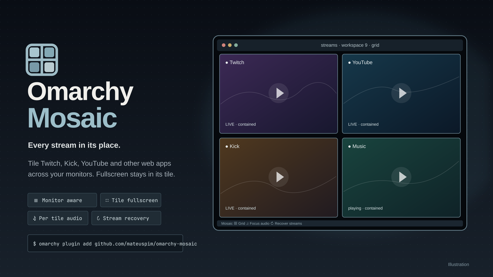

# Mosaic for Omarchy



Web apps such as Twitch, Kick, and YouTube, tiled as a mosaic on Hyprland,
where a video's fullscreen stays inside its tile. It's an Omarchy shell
plugin: a service plus a bar widget. The panel lists your mosaic sessions and
their tiles, and lets you add one of your installed web apps (such as the ones
Omarchy's web app installer creates) or any URL as a tile, focus or remove a
tile, close a session, and turn fullscreen containment back on. The icon dims
when no tiles are open.

The service reads Hyprland's window tags and
`~/.local/state/mosaic/tiles.json`, the same sources the older `mosaic` CLI
used, so the bar, the CLI, and ordinary Hyprland bindings always agree. It
refreshes when Hyprland opens, closes, moves, floats, fullscreens, or
retitles a window. Tiles open in your default browser, which must be
Chromium-based (Chromium, Chrome, Brave, Edge, Opera, Vivaldi, or Helium);
the widget's **Browser** setting picks another Chromium-family command.

## Install

Mosaic needs Omarchy with Hyprland's Lua config (tested on Hyprland 0.56.2)
and a Chromium-family browser. Add and enable the plugin, then add the
**Mosaic** widget to the bar in the shell's settings:

```bash
omarchy plugin add https://github.com/mateuspim/omarchy-mosaic.git --enable --yes
```

For the `mosaic` command, link the wrapper onto your PATH:

```bash
ln -s ~/.config/omarchy/plugins/pym.mosaic/bin/mosaic ~/.local/bin/mosaic
```

## Use

Click the icon, or middle-click it to refresh.

| Key | Action |
| --- | --- |
| ↑ ↓ or J K | Select a tile (or a hidden web app) |
| ← → or H L | Switch between the Tiles, Hidden, and Extension tabs |
| Enter | Focus the selected tile, or show the selected hidden web app again |
| M | Mute or unmute the selected tile (needs the browser extension) |
| F | Turn "Only the focused tile plays" on or off |
| − and + (or =) | Turn the selected tile's volume down or up by 10% |
| G | Cycle the selected tile's session through the layouts: Grid, Stack, Main + small, 16:9 fit, and back to Hyprland's own |
| S | Swap the selected tile's web app: the tile's card opens a picker: a web app (1–9), or its address to edit (A, then Enter). Esc cancels |
| I | Save the selected tile as a web app, when no web app matches it (a tile opened from a typed address, such as `music.youtube.com`): its card asks for the name, prefilled from the page title, and Enter installs an Omarchy web app for the site with its icon. Esc cancels |
| X or D | Remove the selected tile |
| Shift+D | Close the selected tile's session |
| 1–9 | Add that web app to the session |
| A | Type a URL or web app name to add (Enter adds, Esc returns to the list) |
| C | Turn fullscreen containment back on |
| Shift+R | Turn "Recover dropped streams" on or off |
| P | Reload the selected tile's page (needs the browser extension) |
| R | Refresh the tiles |
| Esc | Close the panel |

The web app buttons are the installed web apps, and they update as web apps
are installed or removed. Right-click a button to hide that web app, or list names in the
widget's **Hidden web apps** setting (for example `Tailscale, WhatsApp`).
The panel's **Hidden web apps** tab lists them; select one there to bring its
button back. Typing a web app's name in the
address field works for hidden ones too. A bare
host such as `twitch.tv/name` gets `https://`. Tiles go to the session in the
session field, or else the selected tile's session, or else `default`. New tiles join the workspace where that session already has
tiles, and otherwise go to the focused monitor.

To swap the tile you're looking at without opening the bar first, press
**Super+Shift+S** on it. A card opens over the tile with your web apps
(1–9) and the tile's address, ready to edit (A, then Enter), so you can
switch to another site or just another channel; Esc or a click on the tile
closes it. Errors arrive as a notification.
Change the key in the widget's **Swap key** setting (written like
`SUPER + SHIFT + S`), or clear it to have none; a key another binding
already uses is refused, and a notification and the panel say why. The key
runs `omarchy-shell pym.mosaic swap`. To keep the bind in your own config
instead, clear the setting and add it to `~/.config/hypr/bindings.lua`:

```lua
hl.bind("SUPER + ALT + S", hl.dsp.exec_cmd("omarchy-shell pym.mosaic swap"), { description = "Mosaic: swap tile" })
```

The panel's own swap mode (S) opens the same picker on the tile's card. With
the browser extension connected, the tile's page just changes in place: same
window, slot, mute, and volume. Without it, a new window opens and takes
the old tile's session, workspace, slot, and place in the list.

## Layouts

A layout belongs to a **workspace**: set workspace 8 to Grid and workspace
9 to one of your own, and whatever opens there, tiles or not, is laid out
that way. The panel's **Layouts** tab lists your workspaces, each with a dropdown of
layouts (Enter moves to the next one, 0 hands it back to Hyprland's own).
Each session header on the Tiles tab shows the layout of the workspace its
tiles are on, and its grid button (or **G** on a tile) switches it.

- **Grid**: a balanced grid; a short last row stretches across.
- **Stack**: one row on a landscape monitor, one column on a portrait one.
- **Main + small**: the first tile takes 70% of the monitor, the rest line
  up beside it (or below it, on a portrait monitor).
- **16:9 fit**: the largest 16:9 tiles that fit, centered.
- **Your own layouts**, below.
- **Hyprland**: the workspace's own layout again.

**Design your own** on the Layouts tab with **N** (or E on one to edit
it), by mouse or keyboard. Start from a preset (Columns, Rows, Grid, Main +
side; T cycles them), then shape it on the preview: drag the lines between
zones to resize them, and hover a zone for its buttons: split it beside or
below (S, B), make it the main zone (★, M), or remove it (×, X). ←/→ pick a
zone and −/+ resize it from the keyboard. The main zone gets the first
window, the others fill in order (the preview numbers them), and when
windows outnumber zones the extra ones share the last zone. The first
preset, Columns 25 / 50 / 25 with the middle one main, puts one tile in the
center and two small ones beside it. The toolbar under the preview does
the same for the selected zone, however small. For detailed layouts,
**Large** (F) opens the editor over the whole monitor, at its shape; Back
(Esc) returns to the panel with your changes. N names the layout, Enter
saves, Esc cancels, and D (twice) deletes one; workspaces using it get
their own layout back.

Tiles stay tiled, so Omarchy's window bindings (swapping included) keep
working. Mosaic saves the choices in `~/.local/state/mosaic/layouts.json`
and applies them again after a Hyprland config reload.

## Saved sessions

Keep a session to open it again later: its tiles, in order, with the
monitor and workspace they were on, that workspace's layout, and each
tile's volume and mute. On the Tiles tab, the 󰆓 button on a session's
header (or **W** on one of its tiles) saves it under its own name, and
saving again updates it. The **Saved** tab lists saved sessions: **Enter**
opens the tiles that aren't open yet, back where they were (on the
focused monitor if that one is gone), **O** switches **Open at login** on
or off, and **D** (twice) deletes one. Saved sessions live in
`~/.local/state/mosaic/saved.json`. To open one with a key, bind
`mosaic restore NAME` in your Hyprland config.

## Audio

Each tile row has a speaker button showing whether the tile is playing
(󰕾, or 󰖀 when turned down), silent (󰕿), or muted (󰖁); click it or press
**M** to mute or unmute. Under it, a slider sets the tile's own volume
(right-click the slider to mute), as the shell's audio panel does for apps;
scrolling over the speaker button, or **−** and **+**, work too. At 100% the
site's own volume control is in charge again. The level holds when the
page reloads or a new video starts, but the site's volume slider can
change it until then.
At the top of the Tiles tab, **Only the focused tile plays** (F) makes the
tile you focus the only one you hear: focusing another tile unmutes it and
mutes the rest, and focusing any other window leaves them as they are.
Turning it off unmutes every tile. From scripts: `omarchy-shell pym.mosaic
mute TILE on|off|toggle`, `volume TILE 40` (or `+10`, `-10`), `media TILE
play|pause|toggle`, and `reloadTile TILE`.

## Dropped streams

Twitch sometimes drops a stream: the picture freezes or the player shows
an error such as "Error #3000", and only a page reload brings it back.
With the browser extension connected, **Recover dropped streams** at the
top of the Tiles tab (on by default, Shift+R) does that reload for you.
The extension watches each tile's video, and a tile counts as dropped
when its video fails, the site shows its player error, or a video that
was playing stands still for 12 seconds without being paused. A player
that gives up behind its spinner counts too: a video that was playing
and then ended or was paused, not by you, for 20 seconds, and a video
that never starts for 20 seconds, as after a reload that hangs. Pausing
by hand (a click or a key in the tile, or `mosaic` media commands) and
an ad playing in another video don't count. Media keys and playerctl
give the page no sign of a hand pause, so a tile paused that way is
reloaded after 20 seconds, at most three times.

A tile that was fullscreen goes fullscreen again once the stream plays:
Mosaic presses its f (the fullscreen key on Twitch, YouTube, and Kick),
which briefly focuses the tile, so it waits until the tile's workspace
is on screen, then hands focus and the cursor back.

It reloads a dropped tile right away, then waits 30 seconds and 2 minutes
before trying again. After three tries in ten minutes it stops and the
tile's row says **stream stalled**; P reloads it by hand. A tile's row
also says when a stream was recovered. It only acts on the sites in the
widget's **Stream recovery sites** setting, `twitch.tv, kick.com` by
default (YouTube doesn't need it). `mosaic streams` shows each tile's
stream and the recent recoveries with the reason, such as
`MEDIA_ERR_DECODE`; they are logged to the shell's journal too.

## The browser extension (for audio control)

Audio control needs a small browser extension,
`extension/`. Every tile shares one browser process and one audio stream
source, so PipeWire can't tell tiles apart; the extension can, from inside
the browser. It talks to the plugin through a native messaging host,
`bin/mosaic-native-host` (Python 3, which Omarchy already has).

Open the panel's **Extension** tab (the Tiles tab warns while it's missing):

1. **Enable** (E) registers the host with every Chromium-family browser
   profile it finds under `~/.config`, and adds the extension to the
   `--load-extension=` line of each browser flags file there, such as
   `brave-origin-flags.conf`. That's how Omarchy loads its own browser
   extensions, so there is nothing to click in the browser.
2. **Restart the browser.** Closing it also closes its tiles.
3. The tab then checks on its own that the extension finds every tile,
   again whenever tiles or the browser's windows change. **Verify** (V)
   also checks that it still answers.

Without a flags file, load the extension by hand: open the browser's
extensions page, turn on Developer mode, choose Load unpacked, and pick the
extension folder (the tab copies its path). **Turn off** undoes Enable; do
that before removing the plugin, so the browser isn't left loading a folder
that's gone. When the plugin brings a newer extension, or the browser is
still running an old copy of it, the Extension tab says so. Load the
current one without closing your tiles: **Open the extensions page** (O)
and press Reload on Omarchy Mosaic (turn on Developer mode if there's no
Reload button). An extension older than 0.5.2 can't open the page, so the
button copies `chrome://extensions/` for the address bar instead. Or
restart the browser (the tab's Restart button, B), which also loads it. The same steps are in the IPC: `omarchy-shell pym.mosaic
extension` (status as JSON), `extensionEnable`, `extensionVerify`, and
`extensionDisable`.

## Security and privileges

Mosaic runs as your user in the Omarchy shell. It does not use `sudo` or install
packages. Tiles load the sites you choose in your
Chromium-family browser; those sites make their usual network requests.

- **Browser access:** the optional extension requests `tabs`, `scripting`,
  `nativeMessaging`, `storage`, and access to all URLs because Mosaic accepts
  arbitrary web apps and watches their video and volume. It reports app-window
  tab URLs, titles, favicons, audio and stream state to the local shell; it
  does not send them to a Mosaic server. The native host accepts only the
  extension ID in `extension/manifest.json`.
- **Local changes:** enabling the extension registers `pym.mosaic` as a native
  messaging host in browser profiles found under `~/.config` and adds its
  folder to existing browser flags files. Turn off removes Mosaic's own host
  registration and its flags entry. The plugin also stores tile URLs in
  `~/.local/state/mosaic/tiles.json`, saved sessions and their URLs in
  `saved.json`, and layouts in `layouts.json` (or under `$XDG_STATE_HOME`).
  Do not save a URL containing a private token if you do not want that token
  stored in these files. The bridge socket and tab mapping live under
  `$XDG_RUNTIME_DIR`.
- **Commands:** Mosaic launches the selected Chromium-family browser through
  `uwsm-app`, runs `hyprctl` for tile and layout actions, and uses
  `omarchy-webapp-install` only when you save a tile as a web app. Processes
  receive argument lists; user input is not passed through a shell. The
  web-app installer fetches a site's icon when you request a save.

## Compatibility

The service builds the version 1 `mosaic list --json` and `mosaic webapps
--json` formats itself, and it adds, focuses, removes, closes, and contains
tiles through Hyprland; it doesn't need the `mosaic` CLI. Tiles the CLI
opened carry over, since both use the same tags and `tiles.json`.

## Command line

The plugin answers `omarchy-shell pym.mosaic <function>`; `bin/mosaic` in
this repository wraps that in the old `mosaic` command, with the same
arguments and output:

```bash
mosaic add --session streams twitch kick.com/somechannel
mosaic list            # or: mosaic list --json
mosaic remove 2
mosaic focus 1
mosaic close --session streams
mosaic contain
mosaic layout                          # workspaces' layouts and your own
mosaic layout --workspace 8 grid       # grid, stack, main, fit, yours, default
mosaic layout --session streams three  # the workspace the session is on
mosaic save streams                    # keep the session to open it later
mosaic restore streams                 # open its tiles that aren't open
mosaic saved           # or: mosaic saved --json
mosaic login streams on                # open it at login (or off)
mosaic forget streams
mosaic reload 2                        # reload a tile's page
mosaic save-app 3 "YouTube Music"      # save a tile as a web app
mosaic streams                         # each tile's stream, recent recoveries
mosaic webapps         # or: mosaic webapps --json
mosaic monitors
```

The list and web app JSON are the version 1 formats the CLI printed. To call
the plugin directly, pass every argument (`""` for none), with targets one
per line: `omarchy-shell pym.mosaic add $'twitch\nkick' streams "" ""`
answers `started N` right away, and `omarchy-shell pym.mosaic result N`
reports how it went.

## Development

For development, symlink the checkout instead of installing a copy:

```bash
ln -s ~/Projects/omarchy-mosaic ~/.config/omarchy/plugins/pym.mosaic
omarchy-shell shell rescanPlugins && omarchy plugin enable pym.mosaic
scripts/dev-watch      # reload the widget on every save
```

The shell's own file watcher does not follow symlinks, which is what
`scripts/dev-watch` makes up for. With a symlink, avoid a bare
`omarchy plugin update`: it treats every git plugin as its own checkout and
would fetch and fast-forward this repository. Pass plugin ids instead.

`git config core.hooksPath .githooks` enables hooks that keep the installed
widget current after commits, pulls, rebases, and checkouts on `master`. A
symlinked install is reloaded, and a copy from `omarchy plugin add` is updated
with `omarchy plugin update pym.mosaic --yes` (log:
`~/.local/state/mosaic/plugin-update.log`; `MOSAIC_NO_INSTALL=1` skips it).

```bash
npm test                               # Model.js and native host tests
omarchy plugin validate .              # manifest check
omarchy-shell shell rescanPlugins      # reload after edits to an installed copy
```
